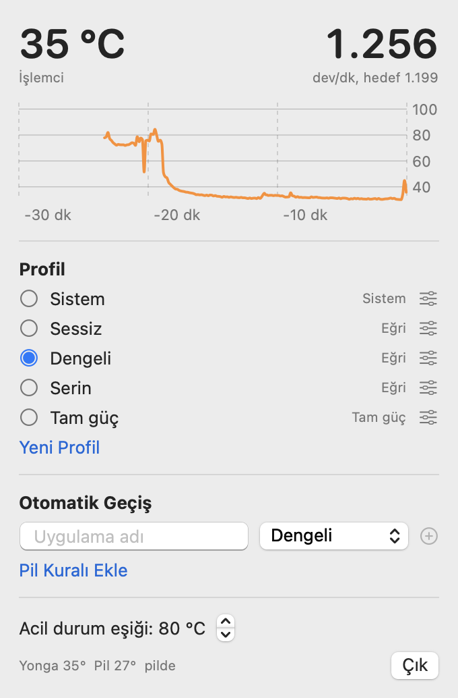
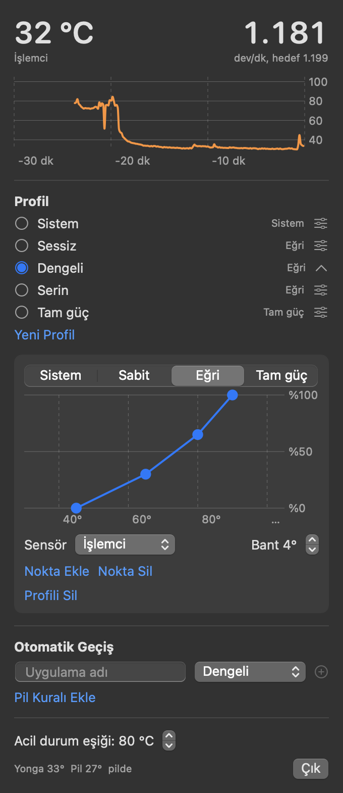
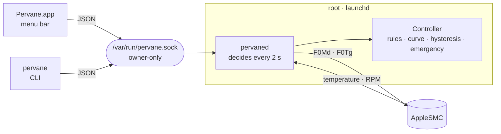

<p align="center">
  
</p>

<p align="center">
  <a href="LICENSE"></a>
  
  
  
  
</p>

<p align="center">
  <b>Take control of your Mac's fan.</b><br>
  Temperature curves, profiles and auto-switch rules, from the menu bar or the command line.<br>
  <sub><a href="README.tr.md">Türkçe</a> · English</sub>
</p>

<p align="center">
  
  &nbsp;&nbsp;
  
</p>

<p align="center"><sub>Live captures from a MacBook Pro M1. The interface is in Turkish for now (<i>pervane</i> means "propeller"); see the <a href="#glossary">glossary</a>.</sub></p>

---

## Why Pervane?

macOS spins the fan up late: the Mac heats up first, then cools down. Pervane drives the fan along a curve you draw, switches to a cooler profile on its own when Docker starts, and goes quiet on battery. It's all under 1,700 lines of Swift with no external dependencies.

| | |
|---|---|
| 📈 **Draggable fan curve** | Move points with the mouse: temperature → fan speed. Up to 12 points per profile. |
| 🎚️ **Four modes** | System, Fixed, Curve, Full power. |
| 🔀 **Auto-switching** | "While this app is running" and "on battery" rules; the first match wins. |
| 🚨 **Emergency brake** | Above a threshold the fan goes to full power whatever the profile, and stays there until things cool down by 8 °C. |
| 🧈 **Smooth ramps** | At most 600 RPM change per tick; a hysteresis band keeps the fan from hunting up and down. |
| 📊 **30-minute history** | Temperature chart right in the menu bar panel. |
| ⌨️ **Command line** | `pervane`, `pervane izle` (watch), `pervane json` for scripts. |
| 🛟 **Safe shutdown** | Whether the service stops or crashes, the fan is handed back to macOS. |

Pervane is free and open source. Other fan control apps for Mac are either paid (TG Pro, Macs Fan Control Pro) or unmaintained (smcFanControl).

## Install

Requirements: macOS 14 or later and the Xcode Command Line Tools (`xcode-select --install`). Apple Silicon is tested; Intel has a code path but hasn't been tried yet.

### Option A: install script

```sh
git clone https://github.com/tuncasoftbildik/pervane.git ~/Developer/pervane
cd ~/Developer/pervane
./kur.sh          # "kur" = install
```

`kur.sh` builds everything, asks for your admin password **once**, and installs three pieces:

| Piece | Location | Job |
|---|---|---|
| `pervaned` | `/Library/PrivilegedHelperTools/com.tunca.pervaned` | Service that drives the fan (root, launchd) |
| Pervane.app | `~/Applications/Pervane.app` | Menu bar panel |
| `pervane` | `~/bin/pervane` | Command-line tool |

To uninstall, run `./kaldir.sh`. The fan goes back to macOS and your settings file is left in place.

### Option B: Homebrew

Homebrew builds Pervane from source on your Mac:

```sh
brew install tuncasoftbildik/tap/pervane
sudo "$(brew --prefix pervane)/libexec/servis.sh" kur "$(brew --prefix pervane)/libexec/pervaned"
open "$(brew --prefix pervane)/Pervane.app"
```

The second line installs the root service. After `brew upgrade pervane`, run it again so the service picks up the new build. To remove the service: `sudo "$(brew --prefix pervane)/libexec/servis.sh" kaldir`.

> [!NOTE]
> Quit Macs Fan Control (or any other fan tool) first. If two programs write to the same fan they keep overriding each other. `kur.sh` quits Macs Fan Control for you.

## Usage

```console
$ pervane
Profil    Dengeli (seçili profil)
İşlemci   64 °C   Yonga 53 °C   Pil 32 °C
Fan 1     2915 dev/dk (%28)  kip: elle  hedef 2909
Güç       adaptör
```

That reads: profile *Balanced* (selected), CPU 64 °C, SoC 53 °C, battery 32 °C, fan at 2915 RPM (28 %) under manual control with a 2909 RPM target, on AC power.

| Command | What it does |
|---|---|
| `pervane` | Status: profile, temperatures, fan speed |
| `pervane profil <name>` | Select a profile |
| `pervane profiller` | List profiles and rules |
| `pervane izle` | Refresh the status every 2 seconds |
| `pervane json` | Raw status for scripts |
| `pervane sensor` | Read directly from the SMC without the service; no root needed |

### Built-in profiles

Percentages are positions between the fan's minimum and maximum speed: 0 % is the minimum RPM, 100 % the maximum.

| Profile | Mode | Curve | Band |
|---|---|---|---|
| **Sistem** (System) | System | macOS decides | – |
| **Sessiz** (Quiet) | Curve | 55° → 0 % · 75° → 25 % · 88° → 60 % · 96° → 100 % | 6 °C |
| **Dengeli** (Balanced, *default*) | Curve | 45° → 0 % · 65° → 30 % · 80° → 65 % · 90° → 100 % | 4 °C |
| **Serin** (Cool) | Curve | 40° → 15 % · 55° → 45 % · 70° → 80 % · 80° → 100 % | 3 °C |
| **Tam güç** (Full power) | Full power | Always 100 % | – |

To add your own profile, click "Yeni Profil" (New Profile) in the panel. There you also pick which sensor drives the curve: CPU, SoC, battery or the hottest of them.

## How it works



`pervaned` is the only thing that writes to the fan. The app and the CLI run unprivileged and talk to the service over a Unix socket, one JSON object per line.

Each tick (2 seconds):

1. **Read.** Performance and efficiency core, SoC and battery temperatures come from the SMC.
2. **Smooth.** An exponential average absorbs one-off spikes; rises are followed quickly, drops slowly.
3. **Pick a profile.** Rules are tried in order; if none matches, the selected profile applies.
4. **Decide.** The curve gives a percentage; speed only drops once the temperature has fallen by the hysteresis band.
5. **Write.** The target is approached by at most 600 RPM per tick. In an emergency there's no ramp.

The decision logic (`PervaneCore/Controller.swift`) is hardware-independent and covered by tests:

```sh
swift test
```

### Source layout

```
Sources/
├── CSMC/          Thin C layer that talks to AppleSMC
├── PervaneCore/   SMC, sensor discovery, config, decision logic, socket protocol
├── pervaned/      The service: the only writer to the fan
├── pervane/       Command-line tool
└── PervaneApp/    SwiftUI menu bar panel (Swift Charts)
```

## Safety

Fan control touches hardware. Pervane guards it like this:

- **Emergency brake.** When the hottest sensor reaches the threshold (97 °C by default, adjustable from 80 to 105), the fan goes to full power. This check uses the raw reading, not the smoothed one.
- **No driving blind.** If a sensor can't be read, the fan is handed back to macOS.
- **Clean exit.** On `SIGTERM`, `SIGINT` or `SIGHUP` the fan is handed back to macOS.
- **Narrow door.** The socket is mode `0600` and owned only by the user who installed Pervane.
- **Clamped settings.** Every setting that reaches the root service from outside is clamped to safe ranges (number of profiles and points, temperatures, percentages).

To try it without writing to the fan, use a dry run (no root needed):

```sh
# terminal 1: the service, without writing to the SMC
PERVANE_SOCKET=/tmp/pervane.sock swift run pervaned --kuru --ayar /tmp/ayar.json

# terminal 2: the CLI, connected to it
PERVANE_SOCKET=/tmp/pervane.sock swift run pervane
```

> [!WARNING]
> Pervane writes to Apple's undocumented SMC interface with root privileges. A curve set too low can run your Mac hotter than necessary. Use at your own risk.

## Compatibility

| Hardware | Status |
|---|---|
| MacBook Pro M1 (MacBookPro17,1), macOS 27 | ✅ Tested |
| Other Apple Silicon Macs | 🟡 Fallback sensor patterns exist, not yet tested |
| Intel Macs | 🟡 Code path exists (`TC0P`-style keys, `fpe2`), not yet tested |
| Fanless Macs (MacBook Air M1 and later) | ❌ No fan to drive |

**Help wanted:** if you have an M2, M3, M4 or Intel Mac, run the command below and [share the output](https://github.com/tuncasoftbildik/pervane/issues/new?template=sensor-raporu.yml). It needs no root and changes nothing.

```sh
swift run pervane sensor
```

## Files

| Path | Contents |
|---|---|
| `/Library/Application Support/Pervane/ayar.json` | Profiles, rules, emergency threshold |
| `/var/run/pervane.sock` | Service socket (override with `PERVANE_SOCKET`) |
| `/var/log/pervaned.log` | Service log: profile changes, errors |
| `/Library/LaunchDaemons/com.tunca.pervaned.plist` | launchd definition |

## Glossary

The interface and CLI are in Turkish for now. Pull requests for localization are welcome.

| Turkish | English |
|---|---|
| İşlemci · Yonga · Pil | CPU · SoC · Battery |
| dev/dk · hedef | RPM · target |
| Profil · Kip · Eğri · Sabit · Tam güç | Profile · Mode · Curve · Fixed · Full power |
| Sessiz · Dengeli · Serin | Quiet · Balanced · Cool |
| Otomatik Geçiş · Pil Kuralı Ekle | Auto-switch · Add battery rule |
| Acil durum eşiği · Bant | Emergency threshold · Hysteresis band |
| kur · kaldır · izle | install · uninstall · watch |

## License

[MIT](LICENSE)

---

<p align="center"><sub>Written next to a hot MacBook. 🌀</sub></p>
