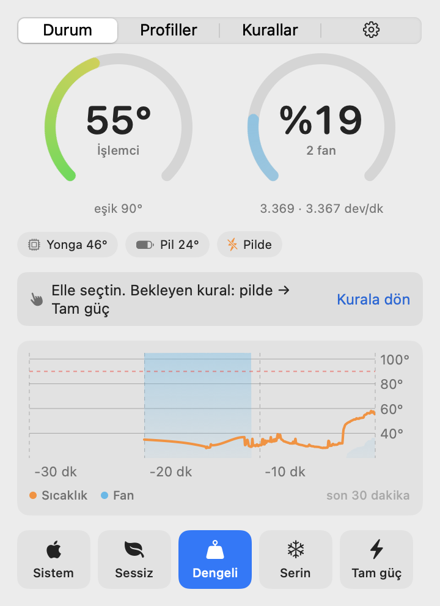
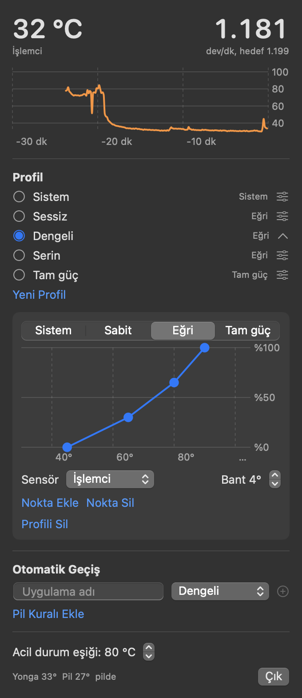
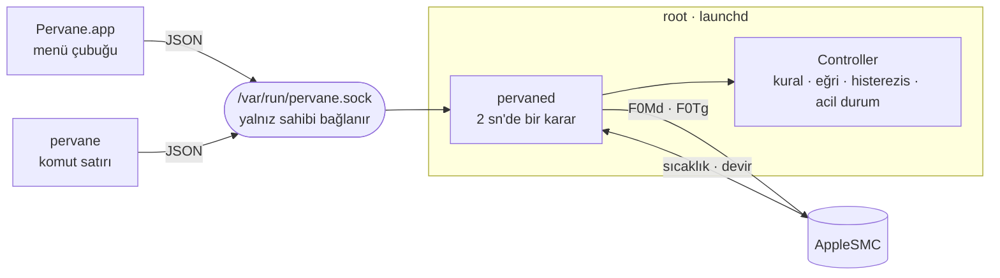

<p align="center">
  
</p>

<p align="center">
  <a href="LICENSE"></a>
  
  
  
  
  
</p>

<p align="center">
  <b>Mac'inin fanını sen yönet.</b><br>
  Sıcaklık eğrileri, profiller, otomatik geçiş kuralları; menü çubuğunda, komut satırında.<br>
  <sub>Türkçe · <a href="README.md">English</a></sub>
</p>

<p align="center">
  
  &nbsp;&nbsp;
  
</p>

<p align="center"><sub>MacBook Pro M1'den canlı görüntüler.</sub></p>

---

## Neden Pervane?

macOS fanı geç devreye sokar; Mac önce ısınır, sonra soğur. Pervane fanı senin çizdiğin eğriye göre sürer, Docker açılınca kendiliğinden serin profile geçer, pile düşünce susar. Hepsi 1.700 satırın altında, dış bağımlılığı olmayan Swift.

| | |
|---|---|
| 📈 **Sürüklenebilir fan eğrisi** | Noktaları fareyle taşı; sıcaklık → devir yüzdesi. Profil başına 12 noktaya kadar. |
| 🎚️ **Dört kip** | Sistem, Sabit, Eğri, Tam güç. |
| 🔀 **Otomatik geçiş** | "Şu uygulama çalışırken" ve "pilde" kuralları; ilk tutan kazanır. |
| 🚨 **Acil durum freni** | Eşik aşılınca profil ne olursa olsun tam güç; 8 °C soğuyana kadar bırakmaz. |
| 🧈 **Yumuşak geçiş** | Tur başına en çok 600 devir; histerezis bandı sayesinde fan inip çıkıp durmaz. |
| 📊 **30 dakikalık geçmiş** | Menü çubuğu panelinde sıcaklık grafiği. |
| ⌨️ **Komut satırı** | `pervane`, `pervane izle`, betikler için `pervane json`. |
| 🛟 **Güvenli kapanış** | Servis dursa da çökse de fan sisteme geri verilir. |

## Kurulum

Gerekenler: macOS 14 veya üstü, Xcode Komut Satırı Araçları (`xcode-select --install`).

> [!TIP]
> Derleme `plugin for module 'SwiftUIMacros' not found` hatasıyla durursa Komut Satırı Araçları'nın SDK'sında (27.2) SwiftUI makro eklentisi yok demektir ve tam Xcode kurulu değildir. Bir önceki SDK ile derle:
> ```sh
> SDKROOT=/Library/Developer/CommandLineTools/SDKs/MacOSX26.5.sdk ./kur.sh
> ```

### A yolu: kurulum betiği

```sh
git clone https://github.com/tuncasoftbildik/pervane.git ~/Developer/pervane
cd ~/Developer/pervane
./kur.sh
```

`kur.sh` derler, yönetici parolasını **bir kez** sorar ve üç parçayı kurar:

| Parça | Yer | İş |
|---|---|---|
| `pervaned` | `/Library/PrivilegedHelperTools/com.tunca.pervaned` | Fanı süren servis (root, launchd) |
| Pervane.app | `~/Applications/Pervane.app` | Menü çubuğu paneli |
| `pervane` | `~/bin/pervane` | Komut satırı aracı |

> [!NOTE]
> Macs Fan Control açıksa `kur.sh` onu kapatır: iki program aynı fana yazarsa birbirini ezer.

Kaldırmak için `./kaldir.sh`. Fan sisteme döner, ayar dosyan yerinde kalır.

### B yolu: Homebrew

Homebrew, Pervane'yi kendi Mac'inde kaynaktan derler:

```sh
brew tap tuncasoftbildik/tap
brew trust tuncasoftbildik/tap   # Homebrew 7 ve sonrası üçüncü taraf tap için onay ister
brew install pervane
sudo "$(brew --prefix pervane)/libexec/servis.sh" kur "$(brew --prefix pervane)/libexec/pervaned"
open "$(brew --prefix pervane)/Pervane.app"
```

İkinci satır root servisini kurar. `brew upgrade pervane` sonrasında yeni derlemenin servise geçmesi için onu yeniden çalıştır. Servisi kaldırmak için: `sudo "$(brew --prefix pervane)/libexec/servis.sh" kaldir`.

## Kullanım

```console
$ pervane
Profil    Dengeli (seçili profil)
İşlemci   64 °C   Yonga 53 °C   Pil 32 °C
Fan 1     2915 dev/dk (%28)  kip: elle  hedef 2909
Güç       adaptör

$ pervane profiller
  Sistem: Sistem
  Sessiz: Eğri (55°→%0, 75°→%25, 88°→%60, 96°→%100)
* Dengeli: Eğri (45°→%0, 65°→%30, 80°→%65, 90°→%100)
  Serin: Eğri (40°→%15, 55°→%45, 70°→%80, 80°→%100)
  Tam güç: Tam güç
  kural: "com.docker" çalışırken → Serin
  kural: pilde → Sessiz
```

| Komut | Ne yapar |
|---|---|
| `pervane` | Durum: profil, sıcaklıklar, fan devri |
| `pervane profil <ad>` | Profili seçer |
| `pervane profiller` | Profilleri ve kuralları listeler |
| `pervane izle` | Durumu 2 saniyede bir yeniler |
| `pervane json` | Ham durum (betikler için) |
| `pervane sensor` | Servis olmadan doğrudan SMC'den okur; root istemez |

### Hazır profiller

Yüzde, fanın en düşük ve en yüksek devri arasındaki konumdur: %0 en düşük devir, %100 en yüksek.

| Profil | Kip | Eğri | Bant |
|---|---|---|---|
| **Sistem** | Sistem | macOS yönetir | – |
| **Sessiz** | Eğri | 55° → %0 · 75° → %25 · 88° → %60 · 96° → %100 | 6 °C |
| **Dengeli** *(varsayılan)* | Eğri | 45° → %0 · 65° → %30 · 80° → %65 · 90° → %100 | 4 °C |
| **Serin** | Eğri | 40° → %15 · 55° → %45 · 70° → %80 · 80° → %100 | 3 °C |
| **Tam güç** | Tam güç | Hep %100 | – |

Kendi profilini panelden "Yeni Profil" ile ekle; eğriyi hangi sensörün süreceğini (İşlemci, Yonga, Pil, En sıcak) de oradan seç.

## Nasıl çalışır?



Fana yazan tek yer `pervaned`. Arayüz ve komut satırı aracı yetkisiz çalışır; servisle Unix soketi üzerinden satır başına bir JSON ile konuşur.

Her turda (2 saniye) olan:

1. **Oku.** SMC'den performans ve verimlilik çekirdekleri, yonga ve pil sıcaklıkları alınır.
2. **Yumuşat.** Tek tük sıçramalar üstel ortalamayla yutulur; yükseliş hızlı, düşüş yavaş izlenir.
3. **Profili seç.** Kurallar sırayla denenir; tutan yoksa seçili profil geçerlidir.
4. **Karar ver.** Eğriden yüzde hesaplanır; sıcaklık histerezis bandı kadar düşmeden devir indirilmez.
5. **Yaz.** Hedefe tur başına en çok 600 devirle yaklaşılır. Acil durumda beklenmez.

Karar mantığı (`PervaneCore/Controller.swift`) donanımdan bağımsızdır ve testlerle korunur:

```sh
swift test
```

### Kaynak düzeni

```
Sources/
├── CSMC/          AppleSMC ile konuşan ince C katmanı
├── PervaneCore/   SMC, sensör keşfi, ayar, karar mantığı, soket protokolü
├── pervaned/      Servis: fanı süren tek yer
├── pervane/       Komut satırı aracı
└── PervaneApp/    SwiftUI menü çubuğu paneli (Swift Charts)
```

## Güvenlik

Fan kontrolü donanıma dokunur; Pervane bunu şu önlemlerle yapar:

- **Acil durum freni.** En sıcak sensör eşiğe (varsayılan 97 °C, 80–105 arası ayarlanır) ulaşınca fan tam güce çıkar. Bu karar yumuşatılmış değere değil ham ölçüme bakar.
- **Kör sürüş yok.** Sensör okunamıyorsa fan sisteme bırakılır.
- **Temiz kapanış.** `SIGTERM`, `SIGINT`, `SIGHUP` gelince fan sisteme geri verilir.
- **Dar kapı.** Soket `0600` izinlidir ve yalnız kurulumu yapan kullanıcıya aittir.
- **Sınırlanan ayar.** Root servise dışarıdan gelen her ayar güvenli aralıklara çekilir (profil ve nokta sayısı, sıcaklık, yüzde).

Fana yazmadan denemek için kuru çalışma (root istemez):

```sh
# 1. terminal: servis, SMC'ye yazmadan
PERVANE_SOCKET=/tmp/pervane.sock swift run pervaned --kuru --ayar /tmp/ayar.json

# 2. terminal: ona bağlanan komut satırı aracı
PERVANE_SOCKET=/tmp/pervane.sock swift run pervane
```

> [!WARNING]
> Pervane, Apple'ın belgelemediği SMC arayüzüne root yetkisiyle yazar. Çok düşük bir eğri Mac'ini gereğinden sıcak çalıştırabilir. Kullanım sorumluluğu sana aittir.

## Uyumluluk

| Donanım | Durum |
|---|---|
| MacBook Pro M1 (MacBookPro17,1), macOS 27 | ✅ Denendi |
| MacBook Pro M5 Pro (Mac17,9), macOS 27 | ✅ Denendi (iki fan; kip anahtarı `F0md`, `Ftst` yok) |
| Diğer Apple Silicon Mac'ler | 🟡 Sensör adları için yedek kalıplar var, denenmedi |
| Intel Mac'ler | 🟡 Kod yolu var (`TC0P` türü anahtarlar, `fpe2`), denenmedi |
| Fansız Mac'ler (MacBook Air M1 ve sonrası) | ❌ Sürülecek fan yok |

Kendi makinende hangi sensörlerin görüldüğüne root olmadan bakabilirsin. M2, M3, M4 ya da Intel Mac'in varsa çıktıyı [sensör raporu olarak paylaş](https://github.com/tuncasoftbildik/pervane/issues/new?template=sensor-raporu.yml):

```sh
swift run pervane sensor
```

## Dosyalar

| Yol | İçerik |
|---|---|
| `/Library/Application Support/Pervane/ayar.json` | Profiller, kurallar, acil durum eşiği |
| `/var/run/pervane.sock` | Servis soketi (`PERVANE_SOCKET` ile değişir) |
| `/var/log/pervaned.log` | Servis kaydı: profil değişimleri, hatalar |
| `/Library/LaunchDaemons/com.tunca.pervaned.plist` | launchd tanımı |

## Lisans

[MIT](LICENSE)

---

<p align="center"><sub>Sıcak bir MacBook'un başında yazıldı. 🌀</sub></p>
